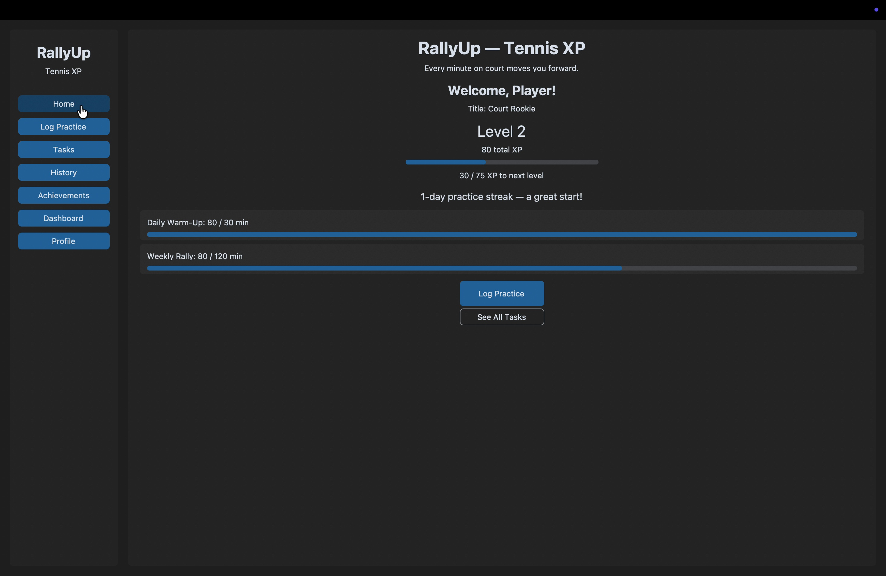
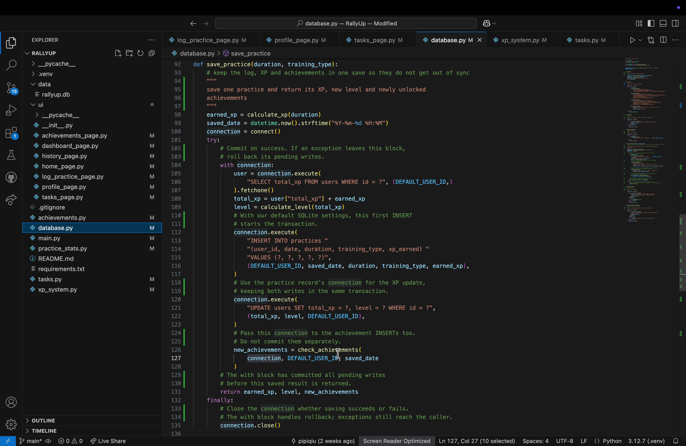
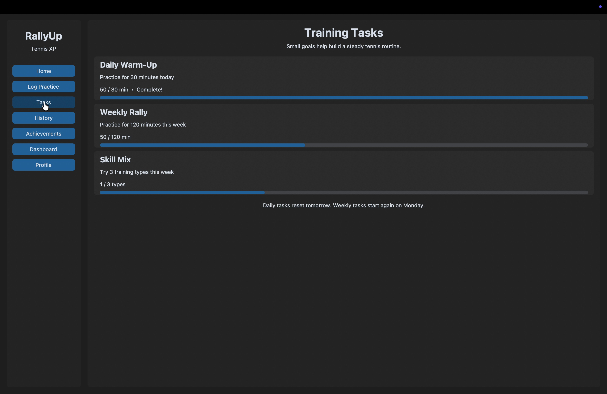
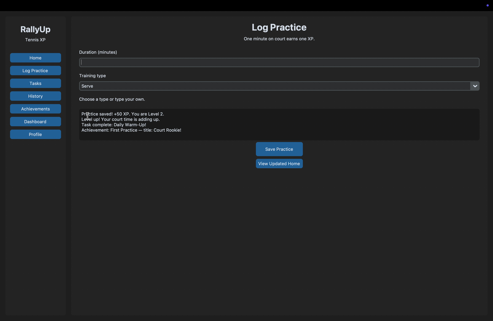
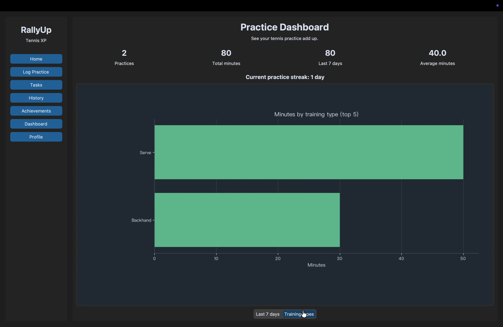
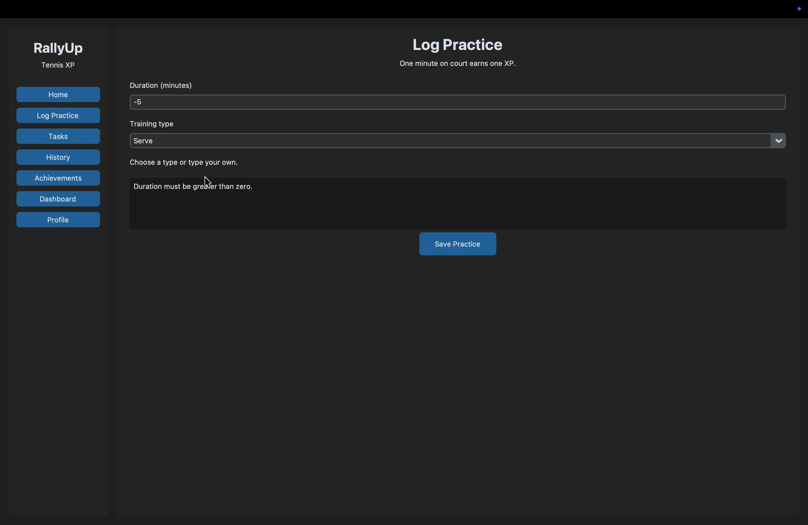

# RallyUp Development Notes

Put together on 19 October 2026 from the earlier development discussions, README and saved recording materials. I have arranged the notes around the problems that came up, rather than trying to assign a date to every change. Feature descriptions follow the current code; demonstration results refer to the saved recording frames.

## 1. What I wanted to make

I wanted a small app for recording tennis practice. The duration and training type were the starting point, but I thought a list of sessions alone might become easy to ignore. I added XP, levels, tasks and titles so there would be a visible change after saving a practice.

I kept the scope fairly small: one local player, no account registration, and data stored on the same computer. There are now seven pages: Home, Log Practice, Tasks, History, Achievements, Dashboard and Profile.

## 2. A simple XP rule still needed some thought

I considered giving different amounts of XP for different training types, but settled on one minute giving one XP. A 30-minute session gives 30 XP, without needing a scoring table. It also makes calculation mistakes easier to spot.

The level requirements increase instead. The first upgrade needs 50 XP, followed by 75, 100 and 125. In [xp_system.py](../xp_system.py), `xp4next_level()` adds 25 to the requirement for each later level.

The part that needed more care was the progress bar. Total XP includes points used for levels already completed. After a 50-minute session and a 30-minute session, the player has 80 XP, but progress within Level 2 should be 30/75. Using 80/75 would be wrong. `caculate_level()` subtracts the earlier requirements and returns the XP left for the current level.

This was a useful example for the demonstration because it shows both the total time invested and the progress towards the next level.

## 3. Working out what happens when Save is pressed

At first, I was unsure whether SQLite needed a separate installation and whether closing the window would lose the records. Python's `sqlite3` works with the local `data/rallyup.db` file. The player, practices and unlocked achievements are stored in three tables. `init_db()` creates missing content without clearing earlier records.

The main save function is `save_practice()` in [database.py](../database.py). Before calling it, the form validates the input and reads the previous level and task progress. Afterwards, it compares the updated values and builds the feedback message.

Teacher feedback made me look more carefully at the transaction. It was not enough to mention rollback in the narration; I needed to be able to follow the code. The practice `INSERT`, player XP `UPDATE` and achievement writes all use the same connection. That connection is passed into `check_achievements()`, which does not open another one or commit separately.

The reason is straightforward. If a practice is saved but its XP is not updated, the next visit shows inconsistent progress. These steps need to succeed together or be undone together.

I also had to distinguish `with` from `finally`. The current code uses SQLite's default transaction settings, so the first practice write starts the transaction. `with connection` manages the commit or rollback, while `finally` closes the connection. If an exception leaves the block, the pending writes are rolled back. This describes the code's behaviour; the recording does not actually trigger a database error. Database errors still reach the caller at the moment, so a clearer error message is something to add later.

## 4. Tasks reset, but achievements stay

Total practice time cannot decide a weekly task. A lot of practice last week should not complete this week's goal. [tasks.py](../tasks.py) therefore counts today's minutes, minutes from Monday to today, and the number of training types used this week separately.

The targets are 30 minutes today, 120 minutes this week and three training types this week. Tasks do not add extra XP, which keeps the one-minute rule easy to follow.

Achievements are stored once unlocked. The seven goals cover the first practice, five practices, 120 minutes, three training types, 500 XP, and three- and seven-day streaks. Each has a title, such as Court Rookie for the first practice.

Two sessions on one day must not count as two streak days. In [achievements.py](../achievements.py), the dates go into a set before consecutive days are counted. If there has been no practice today, the streak can still start from yesterday.

An achievement should not keep appearing as new either. The database's unique constraint and `INSERT OR IGNORE` prevent repeated inserts. `rowcount` tells the form which achievements were actually added by this save. The feedback then shows the new tasks, level-up and titles.

I find this more encouraging than a message that only says the record was saved. It gives the player a reason to notice the result of that session.

## 5. Opening each page was not enough

The interface caused more trouble than I expected. Individual pages could open, but following Home → Log Practice → another module sometimes left a page missing or placed its content too low. There was also a brief flash of text from other modules during switching.

The changes focused on the page containers. In [main.py](../main.py), `show_multiPages()` now builds the next page, places it at the front, and then destroys the old container. Dashboard needs to prepare its charts, and this order is intended to reduce the visible gap while a new page is being built. An unfinished container is also removed if building the new page fails.

Scrolling to the bottom caused another problem: the page could shake. Mouse-wheel handling was tried first, but the layout was later changed as well. History now shows four records per page, Achievements shows three items, and Dashboard displays one chart at a time. The other main pages are kept within a single screen.

Pagination needs another click, but it is easier to fit than one long page. The smallest allowed window is 760×560, and spacing on Tasks was part of the earlier layout changes. The original fault screenshots were not kept; the pictures here come from the later recording.

The main lesson was to try a sequence of actions. Opening every page once does not show what happens when someone saves a practice, changes pages and returns to Home.

## 6. Charts needed room as well as correct numbers

[practice_stats.py](../practice_stats.py) uses Pandas to add up minutes by date and training type. [dashboard_page.py](../ui/dashboard_page.py) uses Matplotlib to draw the results.

The seven-day chart needs to keep days with no practice. Otherwise, rest days disappear from the axis. The summary fills those dates with zero. The training-type chart shows the five types with the most minutes.

Both charts initially took up too much space together. The current page switches between “Last 7 days” and “Training types”. With no records, it shows a prompt first. Returning to Dashboard reads the saved data again, so a newly added session appears in the totals.

There is still a small inconsistency to fix. Tasks ignore case when counting training types, but the chart groups the original text. Serve and serve could therefore appear separately on the chart. I would make that treatment consistent.

## 7. What the demonstration shows

The recording starts by entering minus five minutes. After Save is clicked, the page displays “Duration must be greater than zero.” In the corresponding code, `on_save()` returns when validation reports an error, before calling the database save function.

Saving 50 minutes of Serve then produces 50 XP, Level 2, the Daily Warm-Up completion and the Court Rookie title. After another 30 minutes of Backhand is saved, Dashboard shows two practices, 80 total minutes and a 40-minute average. Home shows 80 total XP and 30/75 progress within the current level. The earlier screenshots retain these results.

These frames show the negative-input warning and feedback after successful saves. They do not show a save failing partway through, the database contents after a failure, or an SQL execution log. The negative-input warning therefore cannot be described as a rollback test or as evidence of rollback occurring on screen.

Level boundaries such as 49 and 50 XP, tasks across a week boundary, repeated dates and empty history have expected rules in the code, but the retained demonstration does not show each case being tried. To report those cases as test results, their steps and outcomes would also need to be recorded.

## 8. What I would work on next

The task targets are fixed, so I would like players to choose goals that suit their training. Database errors also need a useful message rather than an exception during use.

Editing and deleting practices would be useful, but there are decisions behind those buttons. XP and totals would need recalculating, and I would need a consistent rule for achievements already earned from a deleted session.

Looking back, I concentrated more on getting the features working than on keeping organised notes. Next time a layout problem appears, I would save the screenshot and steps before changing anything, then note what fixed it. That would be easier than piecing the process together at the end.

## Related material and appendix access

- [Project overview and running instructions](../README.md)
- [Code concept map](evidence/code_concept_map.pdf)

